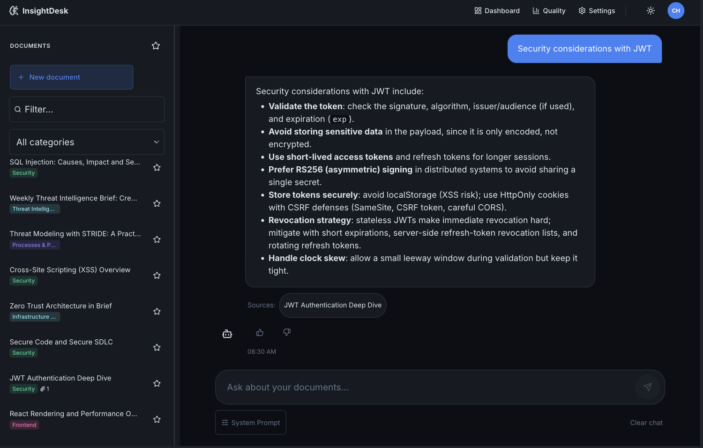
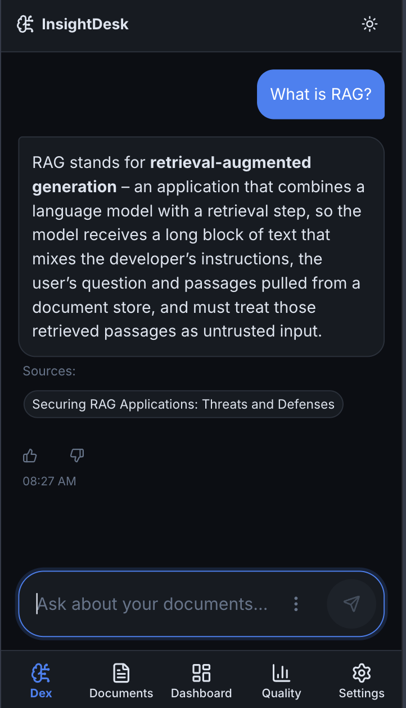
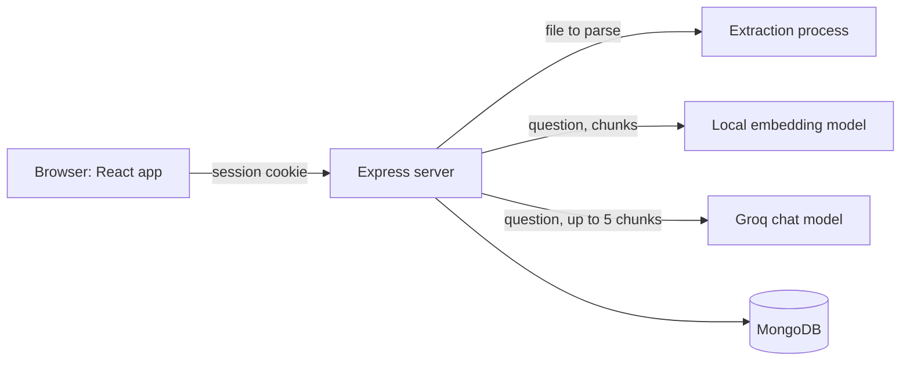

# Insight Desk

[](https://github.com/chenleiv/insight-desk/actions/workflows/ci.yml)

A document workspace with a chat that answers from your documents and cites its sources. The assistant in the chat is called Dex.

It is built for teams that keep their knowledge in internal documents, and it is a portfolio project for AppSec and engineering work.

**Live demo: <https://insight-desk-bwji.onrender.com>.** No sign-up is needed. Each visitor gets a private workspace with sample documents, which is reset on sign-out.

## Features

- **Chat over documents.** Answers come from the documents the user may read. Source chips below an answer open the cited document.
- **Documents with attachments.** Attach PDF, DOCX, XLSX, XLS, TXT, Markdown or RTF files. Their text is extracted and included in the chat's search.
- **Import and export.** Import JSON, TXT or Markdown with a preview, and export the library as JSON. A single document downloads as Markdown, PDF or Word.
- **Dashboard and Quality view.** The dashboard shows document and usage totals and recent documents. The Quality view shows retrieval scores, "no information" answers and user ratings for the last 7 or 30 days.
- **Demo workspace.** A private copy of 15 sample documents, with limits on daily questions and on storage.
- **Mobile layout.** A phone layout with bottom navigation, and light and dark themes on every screen size.

## Screenshots

All screenshots use the dark theme.

<table>
  <tr>
    <td valign="top">
      
      <br />A chat answer on desktop, with the document it came from.
    </td>
    <td valign="top" align="center">
      
      <br />The chat on a phone, with bottom navigation.
    </td>
  </tr>
</table>

Try it yourself in the [live demo](https://insight-desk-bwji.onrender.com).

## Security

The full list of controls, the tests that guard them and the accepted gaps are in [SECURITY.md](SECURITY.md).

- **Client address.** The server reads it from `X-Forwarded-For`, trusting only the number of proxies set in `TRUST_PROXY_HOPS`, and none when unset. Per-address limits count an IPv6 client by its /56 network.
- **Usage budget.** Per UTC day, tokens stop at 130K for demo users and 150K for viewers, and questions stop at 15 per demo workspace, 30 per demo address and 50 per viewer. Atomic database updates hold these limits under parallel requests.
- **Uploads.** Files are limited to 10 MB, or 2 MB in the demo. The first bytes must match the file type, and ZIP-based files are limited to 20 MB when expanded. Attachments are served as downloads with `nosniff` and `no-store`.
- **Parsing.** Each uploaded file is parsed in a separate process with an empty environment and limits on memory and time, so a hostile file can kill only that process.
- **Accounts.** Self-registration is closed and there are no hard-coded accounts. Passwords are hashed with bcrypt, login timing does not reveal whether an account exists, and failed logins are limited per address and per account.
- **Sessions.** The session is a JWT with HS256 pinned. Logging out or changing the password ends existing sessions. Outside development and test, the server refuses to start without a real secret.
- **Browser.** `helmet` sets a CSP with no inline scripts, and HSTS. The cookie is HttpOnly and `SameSite=Lax`, with the `__Host-` prefix in production. State-changing API requests from another origin are refused.
- **Data access.** Chat search covers only the documents the authenticated user may read, and a demo user can reach only their own workspace.

Known gaps, such as `'unsafe-inline'` in the CSP `style-src` and the absence of a pre-parse size check for PDF files, are also documented in [SECURITY.md](SECURITY.md).

## How it works



Retrieval pipeline:

1. **Chunking.** A document's content and each attachment are split separately into chunks of 600 characters with 120 overlap.
2. **Embedding.** A local model, `Xenova/all-MiniLM-L6-v2` at a pinned revision, turns each chunk into a 384-number vector. Document text does not leave the server at this step.
3. **Search.** A question is embedded the same way and compared by cosine similarity with the chunks the user may read. A question in a non-Latin script is first turned into English keywords by the chat model.
4. **Threshold and top results.** The top 5 chunks are kept if they score at least 0.3. If none does, the server returns a fixed "not found" answer and does not call the chat model.
5. **Answer.** Groq's `openai/gpt-oss-20b` model answers from those chunks and cites them.
6. **Citation check.** Citations are compared with the retrieved chunks. Any that do not match are removed from the answer, so a source chip always points to a chunk that was retrieved.

What is stored where:

| Location | Data |
| --- | --- |
| MongoDB | Users, documents, chunks with vectors, the prompt configuration and daily usage counters |
| MongoDB GridFS | Attachment files |
| MongoDB, 30-day TTL | Retrieval logs: ids, scores and ratings, with no question text, answer text or user ID |
| Groq | Receives the question and retrieved chunks for each answer |
| Browser | The session cookie, plus chat history and display preferences in `localStorage` |

## Quality and evaluation

The evaluation tools, method and limits are described in [docs/EVAL.md](docs/EVAL.md).

- **Retrieval.** On 15 documents and 24 labeled questions, the chosen chunk size puts the right document first for 24 of 24 questions. Chunks of 300 do as well, so this shows the size is not worse, not that it is better.
- **Threshold.** 3 of 15 unrelated questions reach the 0.3 threshold (they go to the model, which should answer "not found"), and 0 of 24 related questions fall below it.
- **Answers.** In the latest run (2026-11-08, 24 related questions, 5 runs per wording), 113 of 120 answers with the app's prompt and 108 of 120 with an experimental wording had a valid citation, with no invented citations. Correctness was not graded.
- **Production signals.** The Quality view and `npm run eval:prod` summarize retrieval logs, which hold no question or answer text.

## Tech stack

- **Frontend:** React 19, TypeScript, Vite, TanStack Query, React Router, SCSS
- **Backend:** Node.js, Express, Mongoose, Zod, helmet, express-rate-limit
- **Data:** MongoDB with GridFS
- **AI:** Groq SDK for the chat model, `@huggingface/transformers` for local embeddings
- **Files:** pdf-parse, mammoth and xlsx for reading; pdfkit and docx for writing
- **Quality:** Vitest, ESLint, CodeQL

## Running locally

### Prerequisites

- Node.js 20.19 or newer on the 20 line, or 22.12 or newer. CI uses Node 24.
- MongoDB running as a replica set, since chunk updates and bulk import use transactions. MongoDB Atlas is one by default; a local instance can be a single-node replica set.
- A Groq API key, for the chat.
- Network access on first use, to download the embedding model and, for the tests, a `mongod` binary.

### Install and start

```bash
npm install
```

Start from `.env.example`: copy it to `backend/.env` and fill it in. The server reads `backend/.env`, or `.env` in the project root if that file does not exist.

```bash
npm run dev:backend   # API server on port 8000
npm run dev           # Vite dev server on port 5173, which forwards /api to the server
```

### Environment variables

| Name | Purpose | In production |
| --- | --- | --- |
| `JWT_SECRET` | Signs sessions and keyed hashes | Required: the server does not start without it |
| `MONGODB_URI` | Database connection | Required |
| `GROQ_API_KEY` | Chat model access | Required for the chat |
| `FRONTEND_URL` | Public URL of the frontend, used for the origin check and redirects | This or `APP_BASE_URL` is required |
| `APP_BASE_URL` | Public URL of the app, used for the origin check and redirects | This or `FRONTEND_URL` is required |
| `TRUST_PROXY_HOPS` | Number of reverse proxies in front of the server | Required behind a proxy |
| `NODE_ENV` | Runtime mode: `development` and `test` relax production checks | Recommended: `production`; unset counts as production |
| `ADMIN_EMAIL` | Email of the first admin, created on an empty database | Needed to create the first admin |
| `ADMIN_PASSWORD` | Password of the first admin | Needed to create the first admin |
| `ENV` | The value `prod` forces production mode | Optional |
| `ACCESS_TOKEN_MINUTES` | Session length in minutes | Optional, default 60 |
| `PORT` | Server port | Optional, default 8000 |
| `LOG_LEVEL` | Log verbosity | Optional, default `info` |
| `GOOGLE_CLIENT_ID` | Google OAuth client | Optional |
| `GOOGLE_CLIENT_SECRET` | Google OAuth client | Optional |
| `BACKEND_URL` | Base URL stored on attachment records; the app does not use it for links | Optional |
| `VITE_API_BASE` | API base URL, read when the frontend is built | Optional: leave unset when one server hosts both |

### Scripts

| Command | What it does |
| --- | --- |
| `npm run dev` | Frontend dev server |
| `npm run dev:backend` | API server with restart on change |
| `npm test` | All tests, once |
| `npm run test:coverage` | All tests with a coverage report |
| `npm run lint` | ESLint |
| `npm run build` | Type check and production build |
| `npm start` | Production server, which also serves the built frontend |
| `npm run eval` | Retrieval evaluation, offline |
| `npm run eval:answers` | Compares prompt wordings through the chat model |
| `npm run eval:prod` | Summarizes stored retrieval logs |
| `npm run reindex` | Rebuilds chunks and embeddings; add `-- --dry-run` to write nothing |
| `npm run embed:demo` | Regenerates the demo's precomputed vectors |

## Testing and CI

The backend tests run against an in-memory MongoDB, and the frontend tests run in jsdom. GitHub Actions runs:

- **Lint, test, build** (`.github/workflows/ci.yml`): `npm run lint`, `npm test` and `npm run build` on Node 24, on pushes to `main` and on every pull request.
- **Dependency audit** (`.github/workflows/ci.yml`): on the same events, fails on a high or critical advisory in a production dependency. A full audit including dev dependencies is reported only. `xlsx` is installed from `vendor/` and is not covered, as [SECURITY.md](SECURITY.md#dependencies) explains.
- **CodeQL** (`.github/workflows/codeql.yml`): scans the JavaScript and TypeScript code on pushes and pull requests to `main`, and weekly.

## Project structure

```text
├── src/            React frontend: pages, components, auth, API clients, hooks, styles
├── backend/        Express server
│   ├── rag/        Chunking, embeddings, search, retrieval logs and stats
│   ├── routes/     Documents, users, health
│   ├── middleware/ Security headers, CORS, rate limits, error handler
│   ├── demo/       Sample documents and precomputed vectors
│   └── scripts/    Reindex, demo vectors, production stats, email normalization
├── shared/         Upload rules used by both server and frontend
├── eval/           Evaluation scripts, question sets and recorded results
├── docs/           Evaluation notes and the agent workflow
├── vendor/         The xlsx package: the npm registry release has known advisories
├── .claude/        Coding agent rules, reviewers and commands
└── .github/        CI and CodeQL workflows
```

This project is built with a coding agent under a plan-and-approve loop. The rules and guardrails are in [docs/AGENT_WORKFLOW.md](docs/AGENT_WORKFLOW.md).

## Known limitations and roadmap

- Google sign-in is planned.
- The demo has daily limits, so its chat can stop until the UTC day resets: 15 questions per workspace, 30 per address and a token budget shared by all demo visitors.
- A demo workspace is deleted on sign-out. Otherwise it stops working 24 hours after it was created and is deleted by the next cleanup, which runs when the server starts and every hour after. It can be deleted sooner when more than 40 are live and it is the least recently active.
- There is no sign-up and no way in the app to create an account. The only account created outside the demo is the first admin.
- Each question loads all chunks the user may read into memory and scores them there, so search cost grows with the library.
- Per-minute and login rate limits are held in memory, so they reset when the server restarts. Daily usage counters are stored in the database.
- PDF download supports the Windows-1252 character set only, which covers English and most Western European text. A document with any other character, such as Hebrew, Polish `ł` or an emoji, is refused and can use Markdown or Word instead.
- The evaluation set is small, as [docs/EVAL.md](docs/EVAL.md#limits-of-this-result) explains; a larger one is the next step for it.
- The hosted demo can be slow on the first load if the server is asleep.

## License

MIT
